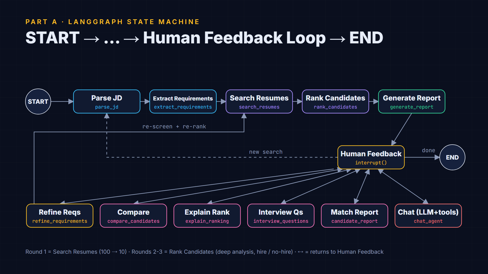

# TalentMatch: LangGraph resume-matching agent (Milestone 3)

A LangGraph agent that screens a pool of **100 resumes** against a job description in three rounds,
explains every ranking with evidence from the resumes, and re-ranks when the recruiter changes the
requirements mid-conversation.

```
you> job_descriptions/senior_frontend_react.txt
  * parse_jd              Read the job brief from job_descriptions/senior_frontend_react.txt (79 words).
  * extract_requirements  must-have = React 3+y, TypeScript, JavaScript, HTML, CSS; nice-to-have = Next.js, GraphQL, ...
  * search_resumes        Round 1: RAG query ... over 100 resumes -> kept top 10 (cut-off quick score 87.6).
  * rank_candidates       Round 2: scored 10 candidates requirement by requirement ... Leader: John Carter (100).
  * rank_candidates       Round 3: hire/no-hire -> Strong Hire 5, Hire 1, Borderline 3, No Hire 1.
  * generate_report       Wrote the explainable match report to output/reports/senior_frontend_engineer_v1.md.
you> Why did John rank higher than Jane?
you> Make GraphQL a must-have and relax React to 2 years
```

| Deliverable | Where |
|---|---|
| LangGraph agent | [`matching_agent.py`](matching_agent.py) (+ [`matching_tools.py`](matching_tools.py), [`rag_search.py`](rag_search.py), [`profiles.py`](profiles.py)) |
| State machine diagram | [`docs/state_machine.png`](docs/state_machine.png), [`docs/state_machine.md`](docs/state_machine.md) (Mermaid exported from the compiled graph) |
| Chat interface (CLI) | [`chat_cli.py`](chat_cli.py) |
| Test scenarios (6 conversation flows) | [`run_scenarios.py`](run_scenarios.py) → `output/scenarios/*.md`; asserted in [`tests/`](tests/test_matching_agent.py) |
| Demo video | `demo/TalentMatch_demo_silent.mp4` (Remotion project in [`video/`](video)); voiceover script in [`DEMO_SCRIPT.md`](DEMO_SCRIPT.md) |

## Quick start

```bash
python -m venv .venv
.venv\Scripts\activate            # macOS/Linux: source .venv/bin/activate
pip install -r requirements.txt

python chat_cli.py --offline --jd job_descriptions/senior_frontend_react.txt   # no API key needed
python chat_cli.py --provider ollama --model <tool-capable local model>        # or any provider in .env
python run_scenarios.py                                                        # the 6 scripted flows
pytest                                                                         # 47 offline tests
```

The 100 resumes are already in `resumes/` (35 PDF, 33 DOCX, 32 TXT). Rebuild them with
`python generate_resume_pool.py` (deterministic, seed 42).

CLI commands: `/state` (requirements + current shortlist), `/graph` (Mermaid), `/new`, `/exit`.

## Part A: agent architecture

### State (`MatchState`)

| Group | Fields |
|---|---|
| Conversation history | `messages` (LangGraph `add_messages`), `pending` (routed intent), `turn` |
| Job understanding | `jd_source`, `jd_text`, `requirements`, `requirements_history` (append-only) |
| Shortlist + reasoning | `screen` (round 1), `shortlist` (rounds 2-3), `previous_shortlist`, `ranking_changes`, `reasoning` (append-only trace), `response`, `report_path` |

State is checkpointed per conversation thread (`InMemorySaver`); `human_feedback` pauses the
graph with `interrupt()` and the UI resumes it with `Command(resume=<message>)`.

### Graph

`START → parse_jd → extract_requirements → search_resumes → rank_candidates → generate_report →
human_feedback ⇄ {refine → search_resumes, compare, explain, interview questions, match report,
chat, new search} → END`. See [`docs/state_machine.md`](docs/state_machine.md).



### Tools

| Layer | Tools |
|---|---|
| Milestone 1 file system ([`fs_tools.py`](fs_tools.py), reused unchanged) | `read_file`, `list_files`, `search_in_file`, `write_file` (sandboxed; writes limited to `output/` for the LLM) |
| Milestone 2 RAG ([`rag_search.py`](rag_search.py)) | `rag_search` (chunks), `search_candidates` (keyword across the shortlist or pool) |
| Milestone 3 matching ([`matching_tools.py`](matching_tools.py)) | `extract_requirements(jd)`, `compare_candidates(candidate_ids)`, `generate_interview_questions(candidate_id)`, `get_match_report(candidate_id)` |

The fixed nodes call these functions directly; the `chat_agent` node binds all of them to the LLM
(`bind_tools`) and runs a tool-calling loop for open questions such as *"Which shortlisted candidates
have AWS experience, and what did they do with it?"*.

**Milestone 2 note:** I couldn't find a Milestone 2 project on this machine, so `rag_search.py`
implements the retrieval layer here: section/role-level chunking, then BM25 with
skill-token query expansion (`ReactJS` = `React.js` = `react`). It needs no embedding model or vector DB. To use your
own Milestone 2 retriever, replace `ResumeIndex.search` / `search_candidates`; the rest of the agent only
depends on those two methods.

## Part B: interactive features

* **Natural language**: rules route the common phrasings deterministically ("compare the top 3",
  "why did X rank higher than Y", "make X a must-have", "interview questions for X", "tell me about X");
  anything the rules can't place goes to the LLM router, and open questions go to the tool-calling chat
  node. First names resolve against the current shortlist first ("John" = shortlisted John Carter, not
  John Doe from the backend pool).
* **Iterative refinement**: `refine_requirements` understands must-have / nice-to-have moves, year
  changes, drops, priorities (double weight) and total-experience changes, and records every
  version. The pool is re-screened, and the report gets a **What changed** section listing each
  candidate's move with the requirement that caused it (e.g. *Yusuf Yilmaz #2 → #4: GraphQL
  (must-have) missing; must-have coverage −9.2*).

## Part C: advanced capabilities

**Multi-round screening**

1. *Initial screen* (`search_resumes`): RAG relevance + must-have presence + experience fit over all 100 resumes → top 10.
2. *Deep analysis* (`rank_candidates`): for each requirement, the years it is **evidenced** in actual
   job roles (overlapping roles merged; "started React in 2025" counts from 2025), versus only **listed**
   in the skills section ("learning TypeScript"). Resume quotes are attached as evidence.
3. *Final round*: Strong Hire / Hire / Borderline / No Hire. A candidate missing a must-have
   can never be a hire, whatever the score.

**Scoring (out of 100)**: must-have coverage 55, depth beyond the bar 5, nice-to-haves 20,
experience fit 15, retrieval relevance 5, then −15 per must-have with no trace at all.

**Explainability**: per-candidate match reports (requirement table with evidence, strengths, gaps),
`explain_pair` (score gap split by component + requirement differences), comparison matrices, ranking
diffs, and **improvement suggestions** for borderline candidates (what evidence would move them to Hire).
Full reports are written to `output/reports/<role>_v<N>.md` (one per requirements version).

**Why deterministic scoring + LLM prose?** Scores you can reproduce and audit are what make "why
did John rank higher than Jane?" answerable. The LLM is used where language matters: requirement
extraction (merged with the parser, restricted to skills the parser can evidence), routing unusual
requests, summaries, and open-ended questions. Every LLM call falls back to the deterministic path
on failure, so the agent also runs **fully offline**.

## Test scenarios

`python run_scenarios.py` runs six conversation flows and writes transcripts (user turn, graph
nodes + reasoning, agent answer) to `output/scenarios/`:

| # | Flow | Turns |
|---|---|---|
| 1 | JD file → 3-round screen → report | JD, "Show me the shortlist again" |
| 2 | Natural-language search + comparison | "Find me candidates with React and 3+ years experience", "Compare the top 3 matches side by side" |
| 3 | Explain a ranking | JD, "Why did John rank higher than Jane?", "Tell me about Jane" |
| 4 | Iterative refinement | JD, "Make GraphQL a must-have and relax React to 2 years", "Actually GraphQL is nice to have again" |
| 5 | Backend role deep dive + interview prep | backend JD, "Tell me about Nina Petrova", "Interview questions for John Doe" |
| 6 | Borderline candidates | ML JD, "Tell me about Vera Takahashi", "Compare Omar Haddad and Vera Takahashi", "done" |

`pytest` (47 tests, no network) covers parsing, retrieval, requirement extraction and refinement,
all three rounds, explainability, intent routing, the graph structure, interrupt/resume, all six
flows, and the LLM paths (tool loop and fallback) with a scripted fake model.

## LLM providers

Same rules as Milestone 1: `--provider` > `LLM_PROVIDER` > first key found in `.env`
(`anthropic`, `openai`, `gemini`, `openrouter`, `ollama`); `--offline` / `LLM_PROVIDER=none` disables
the LLM. Local Ollama uses the native API with `num_ctx=16384` (the OpenAI-compatible endpoint is
stuck at the model's default context, which is too small for tool results).

**Verified:** offline mode (all tests and scenarios), and a local Ollama model (`ornith-1.5:9b`) for
LLM requirement extraction, summaries, routing and the tool-calling chat. Cloud providers use the
same LangChain interfaces but were not run live (no keys available).

## Project layout

```
matching_agent.py        LangGraph state, nodes, router, graph, tools for the LLM
matching_tools.py        requirements, 3 rounds, compare, explain, ranking diffs, questions
rag_search.py            chunking + BM25 index, rag_search tool, candidate name resolution
profiles.py              resume -> structured profile (skill taxonomy, evidenced years)
fs_tools.py              Milestone 1 file tools (unchanged copy)
llm.py                   provider selection -> LangChain chat model (or None = offline)
chat_cli.py              rich terminal chat with a live reasoning trace
run_scenarios.py         6 scripted conversation flows
generate_resume_pool.py  builds the 100 resumes (seed_resumes.py = Milestone 1's 8 + renderers)
export_video_data.py     runs the agent and exports real output for the video
job_descriptions/        3 sample JDs (frontend, backend, ML)
video/                   Remotion project for the demo video
docs/                    state machine diagram
```

## Limitations

* The resume parser expects `Role - Company (YYYY - YYYY|Present)` lines (true for the generated pool and
  common in practice); unusual layouts lose per-skill years and fall back to "listed".
* Skills outside the taxonomy in `profiles.py` can't be evidenced; LLM-extracted requirements are
  limited to known skills for that reason.
* The checkpointer is in-memory; swap `InMemorySaver` for a SQLite/Postgres saver to persist sessions.
