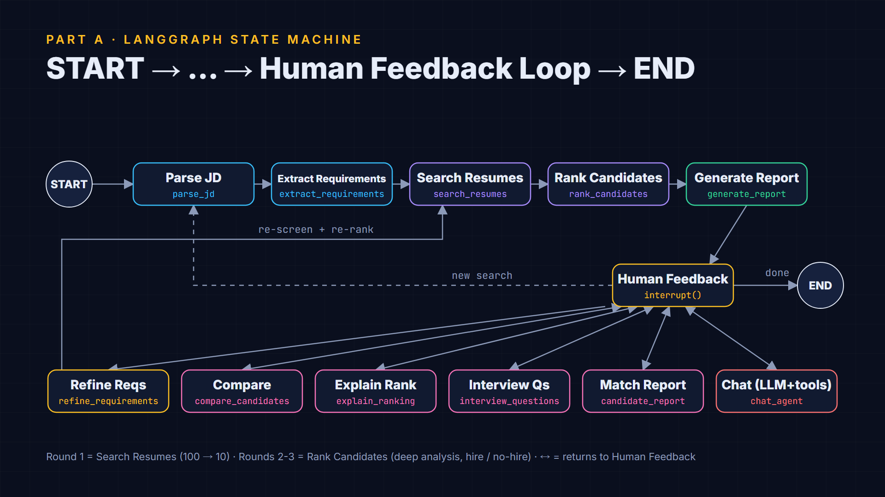
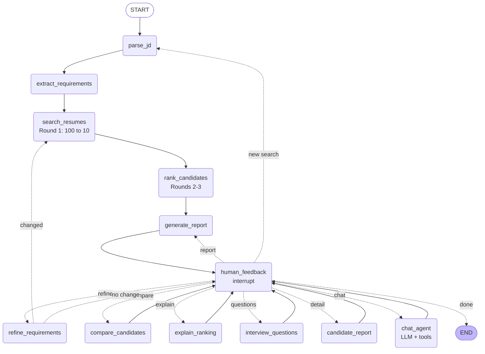

# State machine

`state_machine.png` is rendered from the Remotion diagram (`video/src/components/StateMachine.tsx`,
still `StateMachineDiagram`). The Mermaid below is exported **from the compiled graph itself**
(`MatchingAgent().graph.get_graph().draw_mermaid()`), so it is the authoritative edge list.
Dotted arrows are conditional edges chosen by the router after `human_feedback`.

The raw export is in `state_machine.mmd` (regenerate with
`python -c "from matching_agent import MatchingAgent; print(MatchingAgent().graph.get_graph().draw_mermaid())"`).

## Node responsibilities

| Node | Brief step | What it does |
|---|---|---|
| `parse_jd` | Parse JD | Loads a JD file through Milestone 1 `read_file`, or takes the chat text |
| `extract_requirements` | Extract Requirements | Must-have / nice-to-have / years (rule parser; LLM merge when configured) |
| `search_resumes` | Search Resumes | **Round 1**: RAG query + quick must-have screen over all 100 → top 10 |
| `rank_candidates` | Rank Candidates | **Round 2** per-requirement evidence scoring, **Round 3** verdicts; diff against the previous shortlist |
| `generate_report` | Generate Report | Shortlist + changes + borderline advice; full match report written to `output/reports/` |
| `human_feedback` | Human Feedback Loop | `interrupt()`; routes the reply (rules first, LLM for ambiguous text) |
| `refine_requirements` | (loop) | Applies "make X a must-have", "relax X to N years", "drop X", "prioritise X" |
| `compare_candidates` / `explain_ranking` / `interview_questions` / `candidate_report` | (loop) | The interactive features; each returns to `human_feedback` |
| `chat_agent` | (loop) | Open questions: the LLM calls file, RAG and matching tools in a loop (max 6 rounds) |
